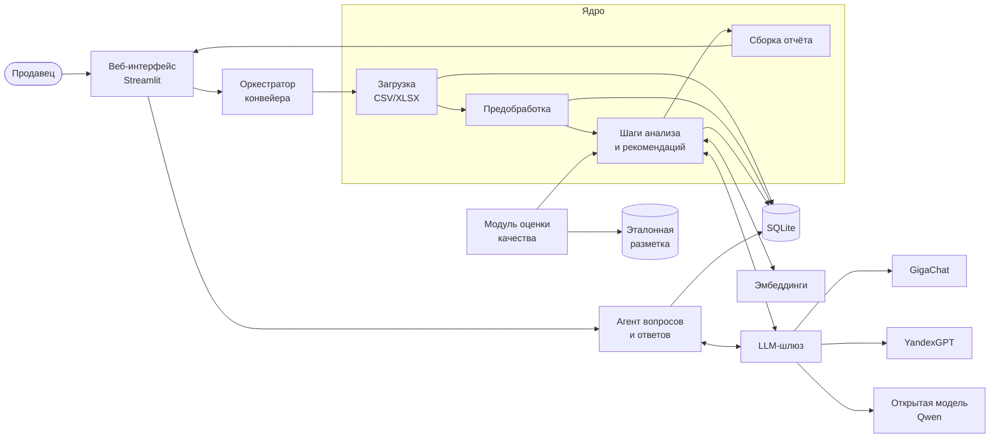
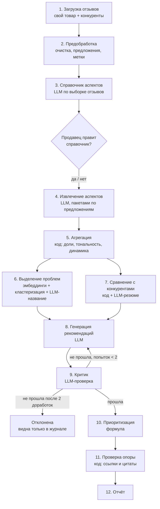
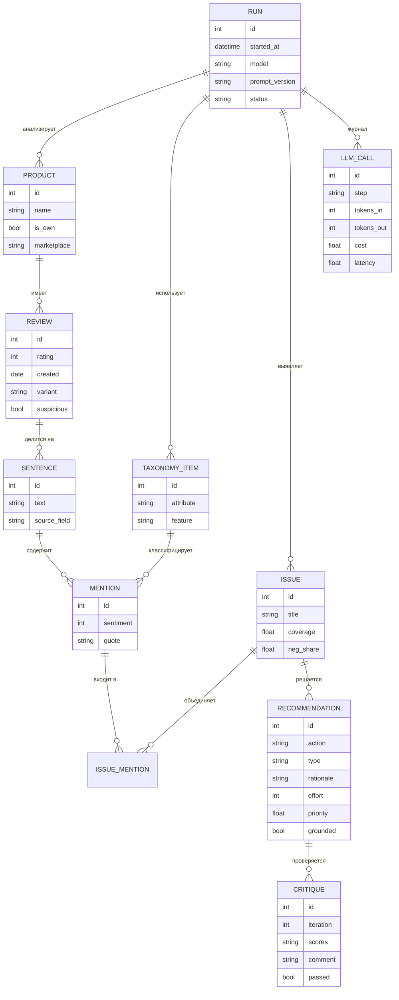

# Архитектура информационной системы

> **Статус:** черновик, подготовлен с помощью ИИ 27.10.2026. Основа: `docs/tz.md` и `docs/analogs.md`. Перед сдачей перепроверить, переписать вручную, отметить в `docs/ai_log.md`. Диаграммы в формате Mermaid отображаются прямо на GitHub; для текста ВКР их можно экспортировать в PNG.

## 1. Общая идея

Система построена как **конвейер (workflow) с агентными элементами**. Это важно сформулировать на защите:

- **Конвейер** — жёсткая последовательность шагов от отзывов к отчёту. Детерминированные шаги (очистка, подсчёты, проверка ссылок) делает обычный код, смысловые (аспекты, проблемы, рекомендации) — LLM.
- **Агентные элементы** — места, где LLM сама решает, что делать дальше:
  1. **цикл «генератор — критик»**: рекомендация проверяется отдельным агентом и дорабатывается, пока не пройдёт проверку или не кончатся попытки;
  2. **агент вопросов и ответов**: отвечает на вопросы продавца, сам выбирая инструменты (поиск отзывов, статистика по аспекту, сравнение с конкурентом).

Такой подход соответствует выводам обзора: многоагентная схема с выделением проблем до генерации рекомендаций даёт более конкретные советы и меньше повторов (Bhandari et al., 2026).

## 2. Компоненты



| Компонент | Ответственность | Требования ТЗ |
|---|---|---|
| Веб-интерфейс | Загрузка файлов, сопоставление колонок, запуск анализа, просмотр отчёта и примеров отзывов, чат с агентом | FR-1, FR-19, FR-21 |
| Оркестратор | Запускает шаги по порядку, сохраняет промежуточные результаты, позволяет перезапустить шаг без повтора предыдущих | — |
| Загрузка | Чтение CSV/XLSX, сопоставление колонок, привязка к товару (свой / конкурент) | FR-1 |
| Предобработка | Очистка, дедупликация, разбиение на предложения, метка подозрительных отзывов | FR-2…FR-4 |
| Шаги анализа | Справочник аспектов, извлечение, агрегация, проблемы, сравнение, рекомендации, критик, приоритеты, проверка опоры на отзывы | FR-5…FR-17 |
| LLM-шлюз | Единый интерфейс к моделям, проверка ответа по схеме, повторы, кэш, журнал запросов, подсчёт токенов и стоимости | NFR-3…NFR-6 |
| Эмбеддинги | Векторные представления предложений для кластеризации проблем | FR-10 |
| Сборка отчёта | Отчёт в интерфейсе, экспорт в DOCX/PDF | FR-18, FR-20 |
| Агент вопросов | Ответы на вопросы с вызовом инструментов | FR-21 |
| Модуль оценки | Прогон на эталонной разметке, метрики, сравнение моделей | раздел 6 ТЗ |

## 3. Конвейер анализа



### Шаг 2. Предобработка
- Нормализация текста, удаление пустых отзывов и точных дубликатов.
- Поля «Достоинства», «Недостатки», «Комментарий» склеиваются, у каждого предложения сохраняется поле-источник. Это подсказка для тональности: предложение из «Недостатков» почти всегда негативное.
- Разбиение на предложения библиотекой `razdel` (проект Natasha, рассчитана на русский язык).
- **Подозрительные отзывы:** почти одинаковые тексты (сходство эмбеддингов выше порога) у разных отзывов. Такие отзывы помечаются, учитываются отдельно и не удаляются.

### Шаг 3. Справочник аспектов
LLM получает случайную выборку (~150 отзывов) и предлагает двухуровневый справочник «атрибут → признаки» (по схеме Boughanmi et al., 2025). Для одежды ожидаются атрибуты вроде «Размер и посадка», «Ткань», «Качество пошива», «Цвет», «Упаковка», «Доставка», «Цена», «Соответствие описанию». Справочник сохраняется, продавец может его поправить. Один справочник используется и для своего товара, и для конкурентов, иначе сравнение невозможно.

### Шаг 4. Извлечение аспектов
- Предложения передаются пакетами по 20–30 штук вместе со справочником.
- Для каждого предложения модель возвращает JSON: список упоминаний `{атрибут, признак, тональность ∈ {−1, 0, 1}, цитата}` или пустой список.
- Few-shot: в промпт добавляются 3–5 размеченных примеров, подобранных по сходству с пакетом (по Zhou et al., 2024, подбор примеров важнее их числа).
- Ответ проверяется по схеме (`pydantic`): атрибут и признак должны быть из справочника, цитата должна быть подстрокой предложения. При ошибке запрос повторяется с текстом ошибки, не более двух раз.

### Шаг 5. Агрегация (без LLM)
Для каждого товара и каждого атрибута/признака:
- число упоминаний и **охват** — доля отзывов, где он упомянут;
- распределение тональности и **доля негатива**;
- средняя оценка отзывов с этим упоминанием;
- динамика доли негатива по месяцам (FR-9).

### Шаг 6. Выделение проблем
1. Берутся негативные упоминания своего товара.
2. Внутри каждого атрибута цитаты кластеризуются по эмбеддингам (агломеративная кластеризация с порогом по косинусному расстоянию; число кластеров заранее не задаётся).
3. Для каждого кластера LLM формулирует проблему одной фразой по 5–10 ближайшим к центру цитатам.
4. Кластеры меньше минимального размера (по умолчанию 3 упоминания, как у Ozon) в отдельные проблемы не выделяются.

### Шаг 7. Сравнение с конкурентами
Код сравнивает доли негатива и охват по каждому атрибуту: где свой товар хуже конкурента, где лучше. LLM пишет короткое резюме по таблице различий. Проблемы, которых у конкурентов нет или которые встречаются заметно реже, отмечаются отдельно.

### Шаги 8–9. Рекомендации и критик
- **Генератор** получает проблему, её статистику, примеры отзывов и данные конкурентов и предлагает 1–2 действия в формате: действие, тип (товар / упаковка / карточка товара / размерная сетка / логистика), обоснование, ожидаемый эффект, оценка сложности (1–3).
- Для сильных сторон отдельно генерируются рекомендации для карточки товара: что подчеркнуть в описании.
- **Критик** оценивает рекомендацию по четырём критериям: конкретность, опора на отзывы, выполнимость для продавца, отсутствие повтора с другими рекомендациями. Если хотя бы один ниже порога, рекомендация возвращается генератору вместе с замечаниями. Не более двух доработок. Рекомендация, которая не прошла проверку и после них, в отчёт не попадает, но остаётся в журнале запуска для анализа.
- Для оценки вклада критика (раздел 6 ТЗ) конвейер можно запустить с критиком и без него.

### Шаг 10. Приоритизация
Простая объяснимая формула:

**P = охват × доля негатива × K_конк / сложность**

где охват и доля негатива берутся из шага 5, K_конк = 1,5, если у конкурентов эта проблема встречается заметно реже (это реальное отставание), иначе 1, сложность — от 1 до 3 по оценке генератора. Коэффициенты подбираются на этапе тестирования, в ВКР формула обосновывается.

### Шаг 11. Проверка опоры на отзывы (без LLM)
Каждая рекомендация должна ссылаться на существующую проблему, а проблема — минимум на 3 реальных предложения. Цитаты сверяются с исходным текстом. Всё, что не прошло проверку, в отчёт не попадает (FR-17). Это главная защита от выдуманных выводов.

## 4. Выбор LLM

### Кандидаты (данные на 27.10.2026)

| Модель | Доступ | Стоимость | Комментарий |
|---|---|---|---|
| GigaChat 2 Pro / Max (Сбер) | API для физлиц | Бесплатный лимит Freemium на 12 месяцев: 40 млн токенов Pro, 25 млн Max. Пакет 3 млн токенов Pro — 1 500 ₽ | Хватит на всю ВКР бесплатно. Ограничение: один поток, поэтому медленнее |
| YandexGPT 5.1 Pro | Yandex Cloud AI Studio | ≈ $0,0066 за 1 000 токенов (синхронно), вдвое дешевле в асинхронном режиме | Нужен платёжный аккаунт Yandex Cloud |
| Qwen3.6 35B (открытая) | Yandex AI Studio или локально через Ollama | ≈ $0,0016 / $0,0025 за 1 000 токенов (ввод / вывод) в AI Studio | Открытая модель для сравнения. Локально 35B требует мощного железа; запасной вариант — меньшая модель семейства |

### Оценка расхода
Для 1 000 отзывов (~3 000 предложений): около 120 запросов на извлечение аспектов плюс справочник, рекомендации и критик — порядка **400 тыс. токенов на один полный прогон**. Это около 200 ₽ по пакетному тарифу GigaChat Pro или около $3 у YandexGPT 5.1 Pro. Оценку уточнить замером на MVP (NFR-3).

### Как выбираем
Мини-эксперимент на этапе проектирования: 100 предложений из RuReviews размечаем вручную, прогоняем шаг 4 на каждой модели, сравниваем F1 по аспектам, macro-F1 по тональности, долю ответов с нарушением формата, время и стоимость. Лучшая модель становится основной, открытая остаётся для сравнения в главе 3. Этот эксперимент сам по себе — содержательная часть ВКР.

## 5. Агент вопросов и ответов

Работает по схеме «рассуждение → вызов инструмента → наблюдение» (ReAct). Инструменты:

| Инструмент | Что делает |
|---|---|
| `search_reviews(запрос, атрибут?, тональность?, товар?)` | Находит предложения по смыслу (эмбеддинги) с фильтрами |
| `aspect_stats(атрибут, товар?)` | Возвращает охват, долю негатива, динамику |
| `compare(атрибут)` | Сравнение атрибута со всеми конкурентами |
| `list_issues(товар?)` | Список проблем с приоритетами |

Ограничения: не более 5 вызовов инструментов на вопрос, ответ обязательно со ссылками на найденные предложения. Если модель не поддерживает вызов функций, используется текстовый формат с разбором ответа.

## 6. Модель данных



Таблица `LLM_CALL` нужна сразу для трёх вещей: подсчёт стоимости (NFR-3), воспроизводимость (NFR-5) и материалы для главы 3.

## 7. Структура кода

```
src/review_agent/
├── config.py              # настройки, выбор модели, пороги
├── ingest/                # загрузка CSV/XLSX, сопоставление колонок
├── preprocess/            # очистка, razdel, подозрительные отзывы
├── llm/
│   ├── base.py            # общий интерфейс LLMClient
│   ├── gigachat.py
│   ├── yandex.py
│   ├── ollama.py
│   └── gateway.py         # схема, повторы, кэш, журнал, стоимость
├── prompts/               # промпты в отдельных файлах с номером версии
├── pipeline/
│   ├── taxonomy.py        # шаг 3
│   ├── extract.py         # шаг 4
│   ├── aggregate.py       # шаг 5
│   ├── issues.py          # шаг 6
│   ├── compare.py         # шаг 7
│   ├── recommend.py       # шаг 8
│   ├── critic.py          # шаг 9
│   ├── prioritize.py      # шаг 10
│   ├── grounding.py       # шаг 11
│   └── orchestrator.py
├── qa/                    # агент вопросов и инструменты
├── report/                # отчёт, экспорт DOCX/PDF
└── storage/               # SQLite, модели данных
app/streamlit_app.py       # интерфейс
eval/                      # эталонная разметка, метрики, сравнение моделей
tests/
```

**Стек:** Python 3.11+, `pydantic` (схемы ответов), `razdel` (предложения), `scikit-learn` (кластеризация, метрики), `sentence-transformers` или эмбеддинги провайдера (векторы), `sqlite3`/`SQLModel` (хранилище), `streamlit` (интерфейс), `python-docx` (экспорт), `pytest` (тесты). Конкретные версии фиксируются в `pyproject.toml` при создании проекта.

## 8. Что проверить и решить дальше

- [ ] Поддерживает ли выбранная модель вызов функций и строгий JSON (влияет на агента вопросов и на число повторов).
- [ ] Модель эмбеддингов: эмбеддинги провайдера (GigaChat даёт пакет на 50 млн токенов за 700 ₽) или локальная многоязычная модель.
- [ ] Хватает ли мощности компьютера для локальной открытой модели, или открытую модель берём через облако.
- [ ] Пороги: размер кластера, сходство для подозрительных отзывов, пороги критика — подбираются на этапе тестирования.
- [ ] Диаграммы для ВКР: при необходимости перерисовать в нотации, которую требует кафедра (UML, IDEF0, C4).

## Источники

- [Тарифы GigaChat API для физических лиц](https://developers.sber.ru/docs/ru/gigachat/tariffs/individual-tariffs)
- [Yandex AI Studio: правила тарификации](https://aistudio.yandex.ru/docs/en/ai-studio/pricing)
- [YandexGPT 5.1 Pro (Код Дурова)](https://kod.ru/yandexgpt-5-1-business)
- [Local LLMs 2 years later (MentorCruise, 2026)](https://mentorcruise.com/blog/local-llms-2-years-later-what-changed-whats-obsolete-what-to-run-instead-in-2026-821a/)
- Работы Boughanmi et al. (2025), Bhandari et al. (2026), Zhou et al. (2024) — см. `docs/analogs.md`.
