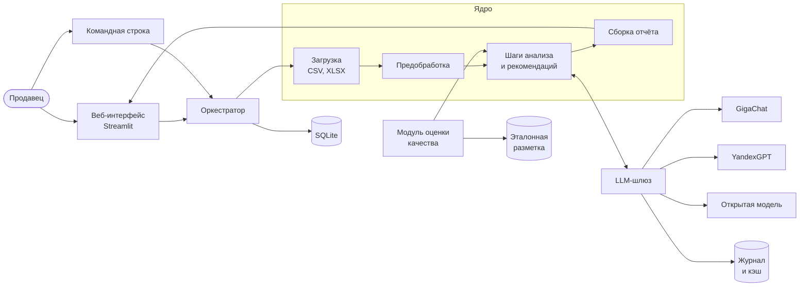
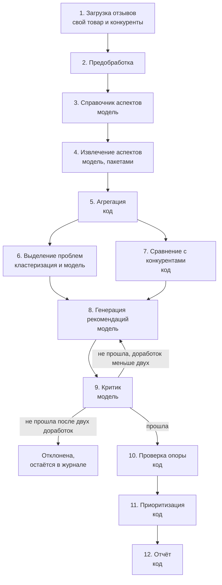
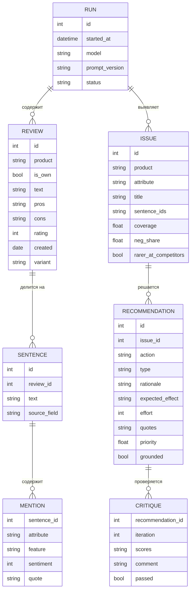

# Глава 2. Проектирование LLM-агента для анализа отзывов

> **Статус:** черновик от 12.11.2026, подготовлен с помощью ИИ на основе `docs/tz.md`, `docs/architecture.md` и написанного кода, записан в `docs/ai_log.md`. Глава описывает проектные решения в том виде, в каком они реализованы в коде на эту дату. Пометка **[уточнить после эксперимента]** стоит там, где значение пока предварительное. Всё описанное реализовано и покрыто тестами, но проверено только на заглушке модели: с настоящей моделью система ещё не запускалась.

## 2.1. Требования к системе

Требования сформулированы в техническом задании по ГОСТ 34.602-2020 (приложение А). Пользователь системы: продавец или менеджер товара на маркетплейсе, который не является аналитиком данных и ожидает готовый отчёт.

Основной сценарий состоит из пяти шагов: продавец загружает файл с отзывами на свой товар, при желании добавляет отзывы на один–три товара конкурентов, запускает анализ, получает отчёт с проблемами и рекомендациями по приоритету и для любого вывода открывает отзывы, на которых он основан.

Функциональные требования делятся на пять групп.

| Группа | Требования | Содержание |
|---|---|---|
| Загрузка и предобработка | FR-1 – FR-4 | Чтение CSV и XLSX, очистка, разбиение на предложения, отметка подозрительных отзывов |
| Аспектный анализ | FR-5 – FR-9 | Атрибуты и признаки, тональность, справочник, агрегация, динамика |
| Проблемы и сравнение | FR-10 – FR-12 | Группировка жалоб в проблемы, сравнение с конкурентами |
| Рекомендации | FR-13 – FR-17 | Генерация, проверка критиком, приоритеты, запрет вывода без опоры на отзывы |
| Отчёт и интерфейс | FR-18 – FR-21 | Отчёт, веб-интерфейс, экспорт, вопросы агенту |

Из нефункциональных требований на проект сильнее всего влияют четыре: замена модели настройкой без изменения кода (NFR-4), воспроизводимость результатов (NFR-5), устойчивость к ошибкам модели (NFR-6) и учёт стоимости запросов (NFR-3). Они определяют устройство слоя работы с моделью, описанного в разделе 2.5.

## 2.2. Общий подход: конвейер с агентными элементами

Систему можно построить двумя способами. В первом языковая модель сама планирует действия и вызывает инструменты, пока не решит, что задача выполнена. Во втором порядок шагов задан заранее, а модель выполняет отдельные смысловые операции. Первый способ гибче, но его результат хуже воспроизводится и труднее проверяется. Для задачи продавца важнее проверяемость: каждая цифра и каждая рекомендация в отчёте должны прослеживаться до отзывов.

Поэтому выбран **конвейер с агентными элементами**. Последовательность шагов фиксирована. Подсчёты, сравнения и проверки выполняет обычный код, модель привлекается там, где нужно понимание текста. Агентными являются два места, в которых модель влияет на ход вычислений:

1. **цикл «генератор — критик»**: рекомендация оценивается отдельным запросом и возвращается на доработку, пока не пройдёт проверку или не исчерпает попытки;
2. **агент вопросов и ответов**, который сам выбирает инструменты для ответа на вопрос продавца (раздел 2.4.11).

Оркестрация написана собственным кодом без агентных фреймворков. Это уменьшает число зависимостей и позволяет объяснить каждый шаг.

Разделение на шаги с выделением проблем до генерации рекомендаций и отдельной проверкой следует схеме Bhandari и соавторов [18]. От неё система отличается тремя решениями: основой служит аспектный анализ на уровне предложений, проблемы сравниваются с товарами конкурентов, а опора рекомендаций на отзывы проверяется программно, а не только моделью.

## 2.3. Архитектура системы

| Компонент | Назначение | Модуль |
|---|---|---|
| Веб-интерфейс | Загрузка файлов, сопоставление колонок, запуск, просмотр результата | `app/streamlit_app.py` |
| Оркестратор | Запуск шагов по порядку, сбор предупреждений, сохранение результата | `pipeline/orchestrator.py` |
| Загрузка | Чтение таблиц, сопоставление колонок | `ingest/` |
| Предобработка | Очистка, дубликаты, разбиение на предложения | `preprocess/` |
| Шаги анализа | Справочник, извлечение, агрегация, проблемы, сравнение, рекомендации, критик, приоритеты, проверка опоры | `pipeline/` |
| LLM-шлюз | Единый доступ к моделям, проверка ответа, повторы, кэш, журнал, стоимость | `llm/` |
| Хранилище | Сохранение отзывов и результатов по запускам | `storage/` |
| Сборка отчёта | Отчёт в Markdown | `report/` |
| Модуль оценки | Метрики на эталонной разметке, сравнение моделей | `eval/` |

Стек: Python 3.11+, pydantic для схем ответов, razdel для разбиения на предложения, scikit-learn для кластеризации, pandas для таблиц, SQLite для хранения, Streamlit для интерфейса, pytest для тестов.

## 2.4. Конвейер анализа

Из двенадцати шагов модель участвует в пяти (3, 4, 6, 8, 9). Остальные детерминированы. Кроме того, модель привлекается к двум дополнительным операциям, не влияющим на основной результат: текстовому резюме сравнения с конкурентами (шаг 7) и советам по сильным сторонам товара.

### 2.4.1. Загрузка и предобработка

Загрузчик читает CSV и XLSX и сопоставляет колонки файла со стандартными полями: текст отзыва, оценка, дата, достоинства, недостатки, вариант товара. Соответствие подбирается по названиям колонок, пользователь может его изменить. Колонки, не выбранные пользователем, не читаются. Так выполняется требование не обрабатывать имена и фотографии покупателей.

Предобработка приводит текст к единой форме Юникода, удаляет служебные символы, пустые отзывы и точные дубликаты в пределах одного товара. Число отброшенных отзывов сохраняется и показывается в журнале.

Отзыв разбивается на предложения библиотекой razdel, рассчитанной на русский язык. Анализ на уровне предложений выбран потому, что в одном отзыве часто встречаются противоположные оценки разных характеристик, а по данным Boughanmi и соавторов [17] такой анализ точнее анализа отзыва целиком. Для каждого предложения сохраняется поле, из которого оно взято (достоинства, недостатки, комментарий): оно передаётся модели как подсказка о тональности.

**Подозрительные отзывы.** Отзывы с почти одинаковым текстом на один товар могут быть накруткой. Для каждого товара тексты отзывов переводятся в векторы TF-IDF по буквенным сочетаниям, и отзыв помечается, если его косинусное сходство с другим отзывом не ниже 0,9 **[уточнить после эксперимента]**. Отзывы короче 30 знаков не проверяются: короткие фразы вроде «всё отлично» совпадают и у обычных покупателей. Помеченные отзывы не удаляются. Продавец видит их число и список в журнале и может исключить их из анализа настройкой.

### 2.4.2. Справочник аспектов

Аспекты описываются на двух уровнях по схеме [17]: **атрибут** обозначает то, что покупатель ценит или ругает в целом («Качество пошива»), **признак** обозначает конкретную вещь («швы»). Модель получает случайную выборку до 150 отзывов и возвращает от 5 до 12 атрибутов с пояснениями и примерами признаков. Выборка берётся из отзывов на все товары сразу, потому что сравнение с конкурентами возможно только при общем справочнике.

Ответ проверяется: число атрибутов в заданных пределах, названия непустые и не повторяются. Вместо справочника от модели можно использовать готовый. Для одежды подготовлен справочник из 11 атрибутов, он же применяется при оценке качества. В обоих случаях справочник показывается продавцу до начала анализа, и он может изменить названия и пояснения, добавить или удалить атрибуты. Так продавец управляет тем, по каким характеристикам будут разобраны отзывы.

### 2.4.3. Извлечение аспектов и тональности

Предложения передаются модели пакетами по 20. Для каждого предложения модель возвращает список упоминаний, каждое из четырёх полей: атрибут, признак, тональность и цитата. Тональность задаётся по трёхбалльной шкале (негатив, нейтрально, позитив), которая по данным [17] надёжнее пятибалльной.

Ответ проходит две проверки. Структурная проверка по схеме pydantic убеждается, что получен JSON с нужными полями и допустимыми значениями. Смысловая проверка убеждается, что в ответе присутствуют все предложения пакета, что атрибут взят из справочника и что цитата дословно содержится в тексте предложения. При сравнении цитаты с текстом не учитываются регистр, различие «е» и «ё» и лишние пробелы. Если проверка не пройдена, запрос повторяется вместе с текстом замечаний, не более двух раз. Пакет, который исправить не удалось, пропускается, а его предложения отмечаются как необработанные.

Требование дословной цитаты решает две задачи: оно не даёт модели приписать предложению то, чего в нём нет, и даёт материал для группировки жалоб на шаге 6.

### 2.4.4. Агрегация

Агрегация выполняется без модели. Для каждого товара, атрибута и признака считаются:

- число упоминаний;
- **охват**: доля отзывов товара, в которых атрибут упомянут. Несколько упоминаний в одном отзыве дают один отзыв;
- распределение тональности и **доля негатива**: отношение числа негативных упоминаний к числу всех упоминаний атрибута;
- средняя оценка отзывов с упоминанием;
- число негативных и всех упоминаний по месяцам.

Охват и доля негатива отвечают на разные вопросы. Охват показывает, насколько тема важна покупателям, доля негатива показывает, насколько они ею недовольны. Атрибут с высоким охватом и низкой долей негатива является сильной стороной товара.

### 2.4.5. Выделение проблем

Проблема понимается как группа близких по смыслу жалоб на один атрибут. Алгоритм:

1. Отбираются негативные упоминания своего товара и группируются по атрибутам.
2. Внутри атрибута цитаты переводятся в векторы и объединяются агломеративной кластеризацией со средней связью по косинусному расстоянию. Число кластеров заранее не задаётся, объединение останавливается на пороге расстояния 0,75 **[уточнить после эксперимента]**.
3. Кластеры меньше трёх упоминаний отбрасываются. Тот же минимум использует ИИ-обзор отзывов Ozon [1].
4. Для каждого оставшегося кластера модель формулирует проблему одной фразой по цитатам, ближайшим к центру кластера (не более десяти). Если модель не ответила, названием служит самая типичная цитата.
5. Для проблемы считается охват: доля отзывов товара, в которых она встречается.

Векторы можно получить двумя способами. Базовый способ: TF-IDF по буквенным сочетаниям длиной от двух до четырёх символов. Он не требует модели и доступа в интернет, но объединяет только фразы с общими буквенными сочетаниями: «швы расходятся» и «расходятся швы на боку» попадают в одну группу, а «шов разошёлся» в неё не попадает. Второй способ: эмбеддинги языковой модели, которые отражают смысл фразы, а не её написание. Они запрашиваются у того же поставщика, что и основная модель, и включаются настройкой. Для них используется отдельный порог расстояния 0,35 **[уточнить после эксперимента]**, так как расстояния между такими векторами заметно меньше. Если модель эмбеддингов не настроена или недоступна, система возвращается к базовому способу и сообщает об этом в предупреждении. Функция построения векторов является параметром алгоритма, поэтому способы заменяются без изменения остального кода.

### 2.4.6. Сравнение с конкурентами

По каждому атрибуту доля негатива своего товара сравнивается со средней долей негатива по товарам конкурентов. Сравнение делается, только если у своего товара и хотя бы у одного конкурента не меньше пяти упоминаний атрибута: на меньших числах доли случайны. Товар считается хуже или лучше конкурентов при разнице долей не менее 10 процентных пунктов, иначе сопоставимым **[оба порога уточнить после эксперимента]**.

Если по атрибуту товар хуже конкурентов, все проблемы этого атрибута получают отметку «у конкурентов встречается заметно реже». Отметка повышает приоритет рекомендаций: такая проблема является отставанием от рынка, а не общим свойством категории. Таблицу сравнения дополняет короткое текстовое резюме, которое пишет модель: в чём товар уступает конкурентам и в чём превосходит. Модель получает только таблицу. Ответ проверяется программно: каждое число с процентом в резюме должно присутствовать в таблице, длина ограничена. Резюме, не прошедшее проверку после повторов, в отчёт не попадает, а таблица остаётся.

### 2.4.7. Генерация рекомендаций и критик

**Генератор** получает название проблемы, её атрибут, охват, долю негатива, сведения о конкурентах и до восьми предложений из отзывов с номерами. Он возвращает одну или две рекомендации. Каждая содержит действие, тип (товар, упаковка, карточка товара, размерная сетка, логистика), обоснование, ожидаемый эффект, оценку сложности от 1 до 3 и от одной до трёх цитат с номерами предложений. Шкала сложности задана в запросе: 1 означает правку карточки товара, 2 означает изменение упаковки, комплектации или размерной сетки, 3 означает изменение самого товара или смену поставщика.

Ответ генератора проверяется программно: тип должен быть из списка, а каждая цитата должна дословно содержаться в предложении с указанным номером. Ответ с выдуманной цитатой возвращается модели.

**Критик** представляет собой отдельный запрос, в котором модель выступает в роли проверяющего эксперта. Он оценивает рекомендацию по четырём критериям от 1 до 5:

| Критерий | Что проверяется |
|---|---|
| Конкретность | Понятно, что именно сделать |
| Опора на отзывы | Действие следует из приведённых предложений |
| Выполнимость | Продавец может сделать это сам или через поставщика |
| Отсутствие повтора | Рекомендация не повторяет уже принятые |

Рекомендация принимается, если все четыре оценки не ниже 4 **[уточнить после эксперимента]**. Иначе генератор получает прошлую версию, оценки и замечания критика и предлагает исправленную рекомендацию. Допускается не более двух доработок. Рекомендация, не прошедшая проверку после них, в отчёт не попадает, но сохраняется в журнале вместе со всеми оценками. Если критик не ответил из-за ошибки модели, рекомендация также не попадает в отчёт.

Цикл можно отключить настройкой. Это нужно для оценки вклада критика: сравниваются рекомендации, полученные с проверкой и без неё (раздел 2.8).

**Советы по сильным сторонам.** Сильной стороной считается атрибут, у которого не меньше пяти упоминаний и не меньше 70 % из них положительные. Для трёх сильных сторон с наибольшим охватом модель предлагает, что добавить в карточку товара: формулировку для описания или сюжет для фотографии. Она получает до восьми положительных предложений из отзывов и обязана привести от одной до трёх дословных цитат, которые проверяются так же, как у рекомендаций по проблемам. Через критика эти советы не проходят и в общий список по приоритету не входят: они не исправляют проблему, а показывают, что уже нравится покупателям.

### 2.4.8. Проверка опоры на отзывы

Последняя проверка перед отчётом выполняется кодом и не зависит от модели. Рекомендация отклоняется, если:

- она ссылается на несуществующую проблему;
- проблема опирается менее чем на три предложения из отзывов;
- у рекомендации нет цитат;
- цитата взята из предложения, не относящегося к проблеме;
- цитаты нет в тексте указанного предложения.

Причина отказа сохраняется в журнале. Так выполняется требование FR-17: вывод без опоры на отзывы не попадает в отчёт. Цитаты проверяются дважды, при генерации и здесь. Первая проверка даёт модели возможность исправиться, вторая гарантирует результат независимо от поведения модели.

### 2.4.9. Приоритизация

Приоритет рекомендации считается по формуле

**P = охват × доля негатива × K / сложность**,

где охват относится к проблеме, доля негатива относится к её атрибуту, K = 1,5 для проблем, которые у конкурентов встречаются заметно реже, и K = 1 в остальных случаях, сложность принимает значения от 1 до 3 **[значение K уточнить после эксперимента]**.

Формула выбрана из соображений объяснимости: продавец видит, из чего сложился приоритет. Частая проблема с сильным недовольством, которую легко исправить, оказывается выше редкой и дорогой в исправлении. Ограничение формулы в том, что сложность оценивает модель, а не продавец. В интерфейсе сложность показывается рядом с рекомендацией, чтобы продавец мог с ней не согласиться.

### 2.4.10. Отчёт

Отчёт собирается кодом из проверенных данных, модель его текст не пишет. Это исключает появление в отчёте утверждений, не прошедших проверки. Отчёт содержит краткую сводку, сильные стороны (атрибуты, у которых не меньше пяти упоминаний и не меньше 70 % из них положительные), проблемы с примерами отзывов, таблицу сравнения с конкурентами и рекомендации по убыванию приоритета с обоснованием и отзывами. Если отзывов на товар меньше 30, отчёт начинается с предупреждения о ненадёжности выводов.

### 2.4.11. Агент вопросов и ответов

После анализа продавец может задать вопрос в свободной форме, например «Что пишут про размер?». Отвечает агент, работающий по схеме «решение модели → вызов инструмента → наблюдение». На каждом шаге модель возвращает либо вызов инструмента, либо окончательный ответ. Результат инструмента добавляется в диалог, и модель решает, что делать дальше.

| Инструмент | Что возвращает |
|---|---|
| Поиск по отзывам | Предложения по запросу с необязательными фильтрами по атрибуту, тональности и товару |
| Статистика по атрибуту | Число упоминаний, охват, доля негатива, динамика по месяцам |
| Сравнение | Доля негатива по атрибуту у своего товара и у конкурентов |
| Список проблем | Найденные проблемы с охватом |

Инструменты работают с результатами уже выполненного анализа и к модели не обращаются. Формат вызова текстовый (JSON), поэтому агент не зависит от того, поддерживает ли модель встроенный вызов функций.

Действуют три ограничения. Число вызовов инструментов не больше пяти. В ответе можно ссылаться только на предложения, которые вернули инструменты в этом диалоге: ссылка на другое предложение отклоняется, и модель получает замечание. Если инструменты вернули хотя бы одно предложение, ответ без ссылок не принимается. В интерфейсе под ответом показано, какие инструменты вызывал агент, и приведены отзывы, на которые он сослался.

Поиск по отзывам использует эмбеддинги модели, если они настроены. Без них поиск идёт по совпадению основ слов и не понимает смысл: запрос «размер» не находит предложение «сильно маломерит». В этом случае агент может ограничить поиск атрибутом «Размер и посадка», и подсказка об этом возвращается ему вместе с пустым результатом.

## 2.5. Слой работы с языковой моделью

Все обращения к модели проходят через один компонент, LLM-шлюз. Он решает четыре задачи.

**Единый интерфейс.** Клиент любой модели реализует одну операцию: принять список сообщений и вернуть текст и число токенов. Реализованы клиент GigaChat с получением временного токена доступа и клиент для серверов с OpenAI-совместимым интерфейсом, через который подключаются YandexGPT и открытые модели. Модель выбирается настройкой (NFR-4).

**Проверка ответа и повторы.** Шлюз извлекает JSON из ответа, проверяет его по схеме и вызывает смысловую проверку шага. При ошибке запрос повторяется с текстом замечаний, по умолчанию не более двух раз. Сетевые ошибки повторяются отдельно, с нарастающей паузой (NFR-6).

**Кэш и журнал.** Ответ на каждый запрос сохраняется в кэше по ключу, составленному из названия модели, параметров и текста запроса. Повторный запуск на тех же данных не обращается к модели. Каждый запрос записывается в журнал: шаг, модель, текст запроса и ответа, число токенов, стоимость, время (NFR-5).

**Учёт расхода.** Шлюз накапливает число запросов, токенов, стоимость, время и число ответов с ошибкой формата. Эти данные выводятся в интерфейсе и используются при сравнении моделей (NFR-3).

Запросы к модели хранятся в отдельных файлах с номером версии в названии. Температура генерации равна нулю.

### Выбор модели

Кандидаты: GigaChat и YandexGPT как российские облачные модели и открытая модель семейства Qwen для сравнения. Выбор делается экспериментом на шаге извлечения аспектов: 100 предложений из RuReviews размечаются вручную, каждая модель обрабатывает их одним и тем же запросом, сравниваются F1 по аспектам, macro-F1 по тональности, доля ответов с ошибкой формата, время и стоимость. **Эксперимент ещё не проведён; результаты приводятся в главе 3.**

## 2.6. Модель данных

Все таблицы привязаны к запуску анализа. Это позволяет хранить результаты разных запусков, например с критиком и без него, и сравнивать их. Повторное сохранение результата шага заменяет прежние записи запуска. Товар не выделен в отдельную таблицу, а хранится названием в отзыве: в одном запуске участвует не более четырёх товаров. Журнал запросов к модели ведётся шлюзом в текстовом файле, а не в базе, чтобы его можно было читать без запуска системы.

## 2.7. Интерфейс пользователя

Интерфейс состоит из одной страницы. В верхней части продавец задаёт название товара, загружает файл и проверяет сопоставление колонок; так же добавляются до трёх товаров конкурентов. Затем он готовит справочник характеристик, при желании правит его в таблице и запускает анализ. В боковой панели выбираются модель, категория товаров, источник справочника, включение критика, группировка жалоб по смыслу и исключение подозрительных отзывов. Во время анализа показывается текущий шаг.

Результат выводится в шести разделах.

| Раздел | Содержание |
|---|---|
| Отчёт | Число отзывов, проблем и рекомендаций; рекомендации по приоритету; сильные стороны с советами для карточки товара; скачивание отчёта |
| Проблемы | Проблемы с охватом и числом упоминаний |
| Характеристики | Таблица атрибутов, диаграмма тональности, признаки, динамика доли негатива по месяцам |
| Сравнение с конкурентами | Текстовое резюме; доля негатива по атрибутам у своего товара и у конкурентов |
| Вопросы | Вопросы агенту в свободной форме, ответы со ссылками на отзывы |
| Журнал | Расход токенов и стоимость, итоги очистки, подозрительные отзывы, отклонённые рекомендации с причинами, справочник |

От любой рекомендации, проблемы, характеристики и ответа агента можно перейти к отзывам, на которых они основаны. Раздел «Журнал» показывает то, что в отчёт не попало. Это сделано намеренно: продавец видит, что система отбросила и почему.

*Рисунок 2.x. Экран с результатом анализа* **[вставить снимок экрана после запуска на настоящей модели]**

## 2.8. Методика оценки качества

Качество оценивается на данных, размеченных человеком. Оценка только с помощью языковой модели, как в [18], не используется как основная, потому что модель-судья может разделять ошибки проверяемой модели.

| Что оценивается | Как | Показатель |
|---|---|---|
| Извлечение аспектов | Эталонная выборка из 300 предложений | Precision, Recall, F1 |
| Тональность | Та же выборка | Accuracy, macro-F1 |
| Согласованность разметки | Две независимые разметки | Каппа Коэна |
| Рекомендации | Экспертная оценка 20–30 рекомендаций по шкале от 1 до 5 | Средний балл по критериям |
| Вклад критика | Запуски с критиком и без него | Разница средних баллов |

Единицей сравнения при оценке аспектов служит пара «предложение, атрибут». Precision показывает долю найденных моделью пар, которые есть в эталоне, Recall показывает долю пар эталона, найденных моделью. Тональность оценивается только на парах, где атрибут определён верно, чтобы ошибка в атрибуте не учитывалась дважды. Отдельно считается, сколько предложений без упоминаний модель верно оставила пустыми.

Базовыми линиями служат готовая модель тональности для русского языка и одиночный запрос к модели без разбиения на шаги.

## Выводы по главе 2

1. Система спроектирована как конвейер из двенадцати шагов, в пяти из которых участвует языковая модель. Подсчёты и проверки выполняет код, что делает результат воспроизводимым и проверяемым.
2. Опора на отзывы обеспечивается на трёх уровнях: дословная цитата при извлечении аспектов, проверка цитат при генерации рекомендаций и программная проверка перед отчётом. Тот же принцип применён к резюме сравнения (проверка чисел) и к агенту вопросов (проверка ссылок).
3. Качество рекомендаций повышается циклом «генератор — критик» с ограниченным числом доработок; цикл отключается для измерения его вклада.
4. Приоритет рекомендации считается по объяснимой формуле из охвата проблемы, доли негатива, сравнения с конкурентами и сложности исправления.
5. Все обращения к модели проходят через шлюз, который проверяет формат ответа, повторяет запросы, ведёт журнал и считает стоимость. Модель заменяется настройкой.
6. Пороговые значения алгоритмов предварительные и уточняются на этапе тестирования.
